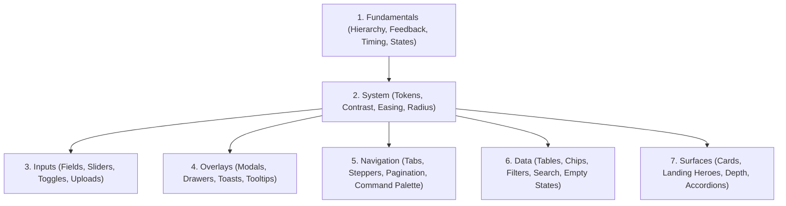

# DesignMotion UX & Motion Pattern Engine

This skill codifies all 76 UX and motion patterns from **designmotionhq.com/patterns** into actionable design rules, implementation standards, and React/MotionUI code patterns.

---

## 1. The 7 Pattern Layers

Every component and screen in an application lives within one of seven layers:

---

## 2. Core Laws & Rules Matrix

### A. Motion & Perception Rules
1. **Doherty Threshold (<400ms)**: Any user interaction taking under 400ms feels instantaneous. Beyond 400ms, always provide visual feedback (button spinner, skeleton, or progress bar).
2. **Animation Timing**:
   - Micro-interactions (hover, active scale): `120ms – 160ms`
   - Surfaces & dialog enter/exit: `200ms – 250ms`
   - Page transitions & drawers: `300ms – 350ms`
   - Never exceed `400ms` for functional UI transitions.
3. **Easing Curves**:
   - `ease-spring`: `cubic-bezier(0.16, 1, 0.3, 1)` for modals, tooltips, cards
   - `ease-bounce`: `cubic-bezier(0.34, 1.56, 0.64, 1)` for toggle knobs, button presses
   - `ease-in-out`: `cubic-bezier(0.4, 0, 0.2, 1)` for smooth progress meters

### B. Visual & Depth Laws
4. **Perfect Card Formula**:
   - Never use stark 1px solid black borders.
   - Use subtle surface contrast + translucent border highlight (`rgba(255, 255, 255, 0.08)` in dark mode, `rgba(0, 0, 0, 0.06)` in light mode).
   - Use compound padding: Inner child elements must have smaller border-radius than outer card (`radius_inner = radius_outer - padding`).
5. **Depth Layers (Elevation 0 to 5)**:
   - Level 0: Flat canvas background (`--mui-color-background-default`)
   - Level 1: Primary cards and containers
   - Level 2: Interactive hover states, popovers, dropdowns
   - Level 3: Sticky headers and bottom sheets
   - Level 4: Modals, dialogs, drawers
   - Level 5: Global toasts, tooltips, command palettes
6. **De-AI Landing Hero**:
   - Avoid generic AI aesthetic: purple gradients everywhere, floating glass spheres, robotic 3D humans, generic buzzwords.
   - Use concrete product interface previews, crisp monochrome typography with tailored accent pills, authentic metrics, and immediate functional CTAs.

### C. Feedback & Interaction Laws
7. **Form Validation Timing**: Never trigger errors on initial typing (`onChange`). Fire validation on `onBlur` (when the user leaves the field). Clear errors immediately on `onChange` as soon as valid.
8. **Disabled Button Fallback**: Never disable a button with zero explanation. If an action cannot be performed, allow click and surface a tooltip or helper message explaining what fields are required.
9. **Optimistic UI**: For actions with a >99% success rate (likes, stars, toggles, bookmarks), update UI state immediately in 0ms; roll back gracefully with toast if network fails.
10. **Undo UX (The 5-Second Window)**: For destructive actions (delete, archive), bypass disruptive confirm dialogs when possible and provide an instant optimistic action with a 5-second "Undo" toast.

---

## 3. Modular Pattern Guides Directory

Detailed component implementation patterns are split into dedicated reference files:

1. [Surfaces, Cards & Landing Heroes](file:///e:/UI%20Library/skills/designmotion_ux_patterns/references/surfaces_cards_heroes.md)
   - *Patterns*: `Perfect Card`, `Card Hover Anatomy`, `De-AI Landing Hero`, `Reverse-Engineered Linear`, `Depth Layers`, `Shadow Elevation`, `Border Radius`.
2. [Overlays, Dialogs & Drawers](file:///e:/UI%20Library/skills/designmotion_ux_patterns/references/overlays_dialogs_drawers.md)
   - *Patterns*: `Modal Hierarchy`, `Bottom Sheets`, `Animation Timing`, `Context Menu`, `Tooltip Design`, `Z-Index Mastery`.
3. [Feedback, Loading & Progress](file:///e:/UI%20Library/skills/designmotion_ux_patterns/references/feedback_loading_progress.md)
   - *Patterns*: `Loading States System`, `Skeleton Loading`, `Toast Notifications`, `Doherty Threshold`, `Optimistic UI`, `Undo UX`, `Error States`.
4. [Inputs, Forms & Controls](file:///e:/UI%20Library/skills/designmotion_ux_patterns/references/inputs_forms_controls.md)
   - *Patterns*: `Form Field States`, `Form Validation Timing`, `Toggle Anatomy`, `Range Sliders`, `Password Field UX`, `OTP Input`, `Date Pickers`, `File Upload UX`.
5. [Navigation, Data & Search](file:///e:/UI%20Library/skills/designmotion_ux_patterns/references/navigation_data_tables.md)
   - *Patterns*: `Tabs System`, `Command Palette`, `Data Table`, `Filter Chips`, `Bulk Actions`, `Search Experience System`, `Drag and Drop`.
6. [Design System Tokens & Accessibility](file:///e:/UI%20Library/skills/designmotion_ux_patterns/references/visual_system_tokens.md)
   - *Patterns*: `Design Tokens`, `Dark Mode`, `Color Accessibility`, `Focus States`, `Gestalt Laws`, `CSS Has Selector`.

---

## 4. Quick Component Application Cheat-Sheet

| Desired UX | MotionUI Component | Core Designmotionhq Pattern Applied |
|---|---|---|
| Floating hint on hover | `<Tooltip placement="top">` | `Tooltip Design`: 150ms delay, arrow alignment, collision padding |
| Interactive container | `<Card interactive elevation={2}>` | `Card Hover Anatomy`: translateY(-3px), elevation shadow expansion |
| Confirmation / Critical Flow | `<Dialog maxWidth="sm" open>` | `Modal Hierarchy` + `Animation Timing`: 250ms scale, backdrop blur |
| Loading placeholder | `<Skeleton variant="rounded" />` | `Skeleton Loading`: Wave shimmer gradient, non-distracting opacity |
| Binary state switch | `<Switch color="primary" />` | `Toggle Anatomy`: Spring morph knob, instant label alignment |
| Multi-tab routing | `<Stack direction="row">` + buttons | `Tabs System`: Zero-jump underline or sliding pill indicator |
| Status alert / feedback | `<Alert severity="success">` | `Notification System`: Semantic icon, dismiss button, high contrast |
