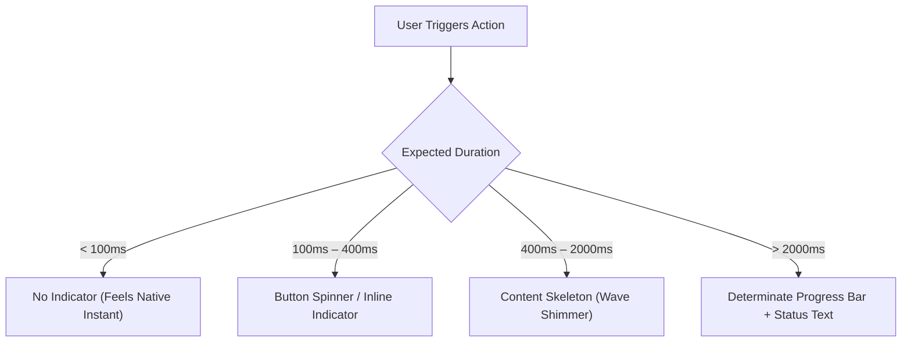

# Feedback, Loading & Progress Guide

This guide covers all feedback, loading, and recovery patterns from **designmotionhq.com/patterns**: `loading-states-system`, `skeleton-loading`, `doherty-threshold`, `optimistic-ui`, `undo-ux`, `error-states`, and `toast-notifications`.

---

## 1. The Loading States Matrix
*Pattern Reference: `loading-states-system`, `doherty-threshold`*

Stop using skeletons for everything or blocking the full screen with giant spinners. Pick the state based on predicted wait duration:



1. **Under 100ms**: No loading state. Showing a spinner for 40ms causes visual flicker and degrades perceived speed.
2. **100ms to 400ms (Doherty Threshold)**: Button loading state. Swap button text for an inline spinner without shifting button dimensions.
3. **400ms to 2.0s**: Skeleton loading. Replace content cards with shimmers matching the exact bounding boxes of text and images.
4. **Over 2.0s**: Show percentage or step indicator (`"Fetching 42 of 100 files..."`).

---

## 2. Skeleton Loading: The Shimmer Wave
*Pattern Reference: `skeleton-loading`*

### The Rules
1. **Never Use Blinking Pulse for Large Cards**: Static opacity pulses (`opacity 0.4 <-> 1.0`) look like a system crash. Use a continuous directional wave shimmer (`transform: translateX(100%)`).
2. **Shape Matching**:
   - Avatars: `variant="circular"`
   - Typography: `variant="text"` with exact heading font size
   - Media: `variant="rounded"` with matching border radius

### Usage in MotionUI:
```tsx
import { Skeleton, Stack, Card, CardContent } from '@motionui/react';

export const CardLoadingSkeleton = () => (
  <Card elevation={1}>
    <CardContent>
      <Stack direction="row" spacing={2} alignItems="center" style={{ marginBottom: 16 }}>
        <Skeleton variant="circular" width={44} height={44} />
        <div style={{ flex: 1 }}>
          <Skeleton variant="text" width="55%" height={20} style={{ marginBottom: 6 }} />
          <Skeleton variant="text" width="30%" height={14} />
        </div>
      </Stack>
      <Skeleton variant="rounded" width="100%" height={160} style={{ marginBottom: 12 }} />
      <Skeleton variant="text" width="90%" height={16} style={{ marginBottom: 4 }} />
      <Skeleton variant="text" width="70%" height={16} />
    </CardContent>
  </Card>
);
```

---

## 3. Circular & Linear Progress
*Pattern Reference: `behind-the-button`, `range-sliders`*

### Determinate vs. Indeterminate
- **Determinate**: Use when exact progress percentage is known (file uploads, battery, migrations).
- **Indeterminate**: Use when waiting on an uncertain server response.

### Usage in MotionUI:
```tsx
import { CircularProgress, LinearProgress, Stack, Typography } from '@motionui/react';

export const ProgressShowcase = () => (
  <Stack spacing={3}>
    <div>
      <Typography variant="caption" color="textSecondary">Upload Progress (68%)</Typography>
      <LinearProgress variant="determinate" value={68} color="primary" />
    </div>

    <div>
      <Typography variant="caption" color="textSecondary">Background Syncing</Typography>
      <LinearProgress variant="indeterminate" color="secondary" />
    </div>

    <Stack direction="row" spacing={3} alignItems="center">
      <CircularProgress size={36} color="primary" />
      <CircularProgress size={36} variant="determinate" value={75} color="success" />
    </Stack>
  </Stack>
);
```

---

## 4. Optimistic UI & Undo UX (The 5-Second Grace Window)
*Pattern Reference: `optimistic-ui`, `undo-ux`*

### The Law
Destructive dialogs ("Are you sure you want to delete?") break user flow. Instead:
1. Delete the item immediately from the client view in 0ms.
2. Show a floating undo toast for 5 seconds.
3. If the user clicks "Undo", revert the client view.
4. If 5 seconds elapse with no undo, commit the deletion to the backend.

### Implementation Pattern:
```tsx
import React, { useState } from 'react';
import { Button, Alert, AlertTitle } from '@motionui/react';

export const OptimisticDeleteList = () => {
  const [items, setItems] = useState(['Document A', 'Document B', 'Document C']);
  const [deletedItem, setDeletedItem] = useState<string | null>(null);

  const handleDelete = (item: string) => {
    setDeletedItem(item);
    setItems((prev) => prev.filter((i) => i !== item));
  };

  const handleUndo = () => {
    if (deletedItem) {
      setItems((prev) => [...prev, deletedItem]);
      setDeletedItem(null);
    }
  };

  return (
    <div>
      {items.map((item) => (
        <div key={item} style={{ display: 'flex', justifyContent: 'space-between', padding: 8 }}>
          <span>{item}</span>
          <Button size="small" variant="text" color="error" onClick={() => handleDelete(item)}>
            Delete
          </Button>
        </div>
      ))}

      {deletedItem && (
        <div style={{ position: 'fixed', bottom: 24, right: 24, zIndex: 1600 }}>
          <Alert
            severity="info"
            variant="filled"
            action={<Button size="small" variant="contained" onClick={handleUndo}>UNDO (5s)</Button>}
            onClose={() => setDeletedItem(null)}
          >
            Deleted {deletedItem}
          </Alert>
        </div>
      )}
    </div>
  );
};
```
