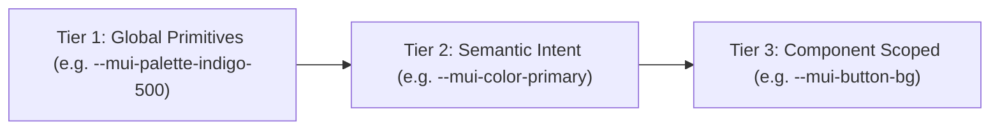

# Visual System, Design Tokens & Accessibility Guide

This guide covers design tokens, themes, accessibility, and visual science from **designmotionhq.com/patterns**: `design-tokens`, `dark-mode`, `color-accessibility`, `gestalt-laws`, `proximity-rule`, `golden-ratio`, `easing-curves`, and `css-has-selector`.

---

## 1. Zero-Tailwind Token Architecture
*Pattern Reference: `design-tokens`, `dark-mode`*

Rather than hardcoded utility classes, modern enterprise libraries use CSS custom properties (variables) organized into 3 tiers:



### Complete Token Categories in MotionUI:
1. **Color Roles**: `primary`, `secondary`, `success`, `warning`, `error`, `info`, `background-default`, `background-paper`, `text-primary`, `text-secondary`, `divider`.
2. **Spacing Grid**: `4px` base factor (`--mui-spacing-1: 4px`, `--mui-spacing-2: 8px`, `--mui-spacing-4: 16px`, `--mui-spacing-8: 32px`).
3. **Radius Scale**:
   - `xs`: 4px (tags, badges)
   - `md`: 8px (buttons, textfields)
   - `lg`: 12px (dropdowns, popovers)
   - `xl`: 16px (standard cards)
   - `2xl`: 24px (dialogs, sheets)
   - `full`: 9999px (chips, avatars, toggles)
4. **Elevation Shadows**: 6 distinct depth levels calculated with dual ambient/contact shadows.

---

## 2. Dark Mode: Never Simply Invert
*Pattern Reference: `dark-mode`*

### The Law
Inverting white to black creates high-contrast glare. Premium dark modes adhere to:
1. **Never Pure `#000000` for Canvas**: Use `#0a0f1d` or `#0f172a` (rich midnight slate).
2. **Desaturate Accent Colors**: Primary saturated `#4f46e5` appears blinding on dark backgrounds; shift to `#818cf8` (+15% lightness, -10% chroma).
3. **Card Layer Elevation**: In dark mode, higher elevation means lighter surface gray, not stronger black shadow.

### Usage in MotionUI:
```tsx
import { ThemeProvider, useTheme, Button } from '@motionui/react';

function ThemeToggler() {
  const { mode, toggleMode } = useTheme();
  return (
    <Button variant="outlined" onClick={toggleMode}>
      Current Mode: {mode.toUpperCase()} (Click to Toggle)
    </Button>
  );
}

export function App() {
  return (
    <ThemeProvider defaultMode="auto">
      <ThemeToggler />
    </ThemeProvider>
  );
}
```

---

## 3. WCAG Color Accessibility Ratios
*Pattern Reference: `color-accessibility`*

1. **Normal Body Text**: Minimum contrast ratio of **`4.5:1`** against background.
2. **Large Text ($\ge$ 18pt or 14pt bold)**: Minimum contrast ratio of **`3.0:1`**.
3. **UI Components & Icons**: Minimum contrast ratio of **`3.0:1`** against adjacent surfaces.
4. **Focus Rings**: Always use high-contrast outline (`2px solid var(--mui-color-primary)`) with a `2px` offset (`:focus-visible`).

---

## 4. Modern CSS `:has()` Selector Magic
*Pattern Reference: `css-has-selector`*

React state management can be drastically simplified by letting CSS `:has()` handle ancestor reaction:

```css
/* Card illuminates whenever its internal checkbox is checked */
.mui-card:has(input[type="checkbox"]:checked) {
  border-color: var(--mui-color-primary);
  background-color: rgba(var(--mui-color-primary-rgb), 0.04);
}

/* Form row highlights whenever any input is focused */
.form-row:has(:focus-visible) {
  border-left: 3px solid var(--mui-color-primary);
}
```

---

## 5. Dynamic Endpoint Colors & Auto-Contrast Adaptation
*Pattern Reference: `color-accessibility`, `design-tokens`, `dark-mode`*

### The Problem
When brand colors arrive dynamically from an API endpoint (e.g. tenant configurations, white-label portals, or theme settings), fixed text colors (`#ffffff`) frequently fail WCAG AA contrast against bright primary colors (e.g. `#fbbf24` yellow or `#06b6d4` cyan).

### The Mathematical Solution
Using the WCAG 2.1 Relative Luminance formula ($Y = 0.2126 R + 0.7152 G + 0.0722 B$):
- If the contrast ratio between the background and pure white is $\ge 4.5:1$, foreground text is `#ffffff`.
- If the background is too bright (e.g. Amber/Gold, Cyan, Light Green), foreground text automatically shifts to `#0f172a` (dark charcoal).

### 1. Simple Drop-in Usage with `AdaptiveThemeProvider`
```tsx
import { AdaptiveThemeProvider, Button, Card, CardContent } from '@motionui/react';

export function TenantApp({ remoteTheme }) {
  // remoteTheme e.g. { primaryColor: '#f59e0b', secondaryColor: '#1e1b4b', mode: 'dark' }
  return (
    <AdaptiveThemeProvider remoteConfig={remoteTheme}>
      <Card elevation={2}>
        <CardContent>
          {/* Button automatically has dark text if primary is yellow/light, white text if primary is dark! */}
          <Button variant="contained" color="primary">
            Auto-Contrasted Action
          </Button>
        </CardContent>
      </Card>
    </AdaptiveThemeProvider>
  );
}
```

### 2. Runtime Brand Switching Hook (`useTheme`)
```tsx
import { useTheme, Button } from '@motionui/react';

export function BrandSwitcher() {
  const { setDynamicBrand } = useTheme();

  return (
    <Button
      onClick={() => setDynamicBrand({ primary: '#10b981', secondary: '#064e3b' })}
    >
      Switch to Emerald Brand
    </Button>
  );
}
```

### 3. Bridging into Existing MUI v5/v6 Applications
```tsx
import { ThemeProvider as MuiThemeProvider, createTheme as createMuiTheme } from '@mui/material/styles';
import { createTheme as createMotionTheme, createMuiCompatiblePalette, ThemeProvider as MotionThemeProvider } from '@motionui/react';

export function UnifiedApp({ tenantPrimaryHex }) {
  // 1. Create MotionUI theme with auto-contrast calculation
  const motionTheme = createMotionTheme({
    palette: { primary: tenantPrimaryHex },
  });

  // 2. Derive standard MUI v5 palette
  const muiTheme = createMuiTheme({
    palette: createMuiCompatiblePalette(motionTheme),
  });

  return (
    <MuiThemeProvider theme={muiTheme}>
      <MotionThemeProvider theme={motionTheme}>
        {/* Both existing @mui/material components and MotionUI components are 100% color & contrast synchronized! */}
      </MotionThemeProvider>
    </MuiThemeProvider>
  );
}
```

