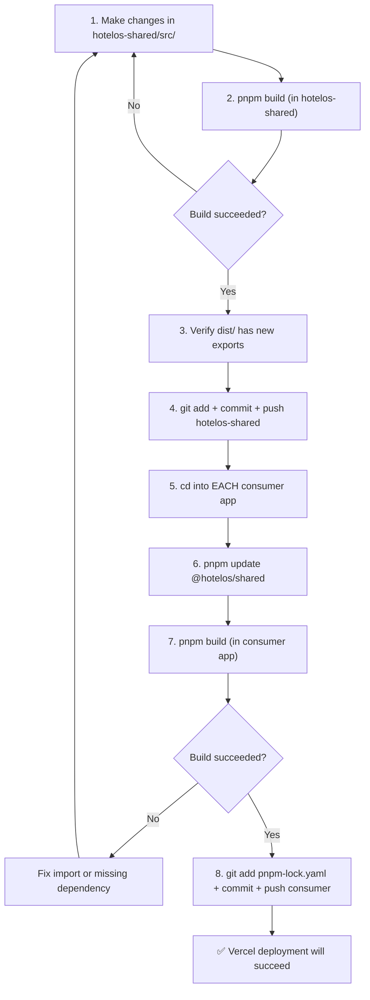

# Vercel Deployment Guard & Shared Package Safety

Prevent deployment failures across all NamiOS frontend apps (Stay OS, Dine OS, Super Admin) by understanding the two-mode dependency architecture, enforcing pre-push validation, and avoiding the most common failure patterns.

---

## 1. The Two-Mode Architecture — Root Cause of Most Failures

NamiOS uses a split resolution strategy for `@hotelos/shared`:

### Local Development (Always Works)
```
vite.config.ts → resolve.alias → ../hotelos-shared/src/utils/index.ts
```
Vite resolves imports directly to the **source `.ts` files** in the sibling directory. This means:
- New exports are available instantly (no build step needed)
- Missing dependencies are resolved from the consumer's `node_modules`
- TypeScript errors are caught by the local dev server

### Vercel Production Build (Where It Breaks)
```
package.json → "@hotelos/shared": "git+https://github.com/rajitha-00/hotelos-shared.git"
              → downloads repo → uses pre-built dist/ directory
```
Vercel installs the **published `dist/` bundle** from the Git repository. This means:
- Only exports that existed when `pnpm build` was last run in `hotelos-shared` are available
- Only dependencies listed in `@hotelos/shared/package.json` (or bundled via `noExternal`) are present
- TypeScript declarations come from the built `.d.ts` files, not live source

> **CRITICAL**: A feature can work perfectly in local development but ALWAYS fail on Vercel if the shared package hasn't been rebuilt and pushed.

---

## 2. Failure Pattern #1 — Missing Exports (TS2305)

### Symptom
```
error TS2305: Module '"@hotelos/shared/utils"' has no exported member 'validateImageFile'.
```

### Root Cause
A new function/component was added to `hotelos-shared/src/` and is imported by a consumer app, but:
1. `hotelos-shared` was not rebuilt (`pnpm build`), OR
2. The new code was not committed and pushed to the `hotelos-shared` GitHub repo, OR
3. The consumer app's lockfile still points to an old commit hash of `@hotelos/shared`

### Prevention Rules

**When adding ANY new export to `@hotelos/shared`**:

```bash
# Step 1: Build the shared package
cd hotelos-shared
pnpm build

# Step 2: Verify the export exists in dist/
# Check that the .d.ts file contains the export
cat dist/utils/index.d.ts | grep "validateImageFile"

# Step 3: Commit and push the shared package FIRST
git add .
git commit -m "feat(utils): add validateImageFile"
git push origin main

# Step 4: Update consumer lockfiles to pick up the new commit
cd ../hotelos-stay-os
pnpm update @hotelos/shared
git add pnpm-lock.yaml
git commit -m "chore: update @hotelos/shared"
git push origin main

# Repeat Step 4 for hotelos-dine-os and hotelos-super-admin
```

**Barrel Export Checklist** — When adding a new file to `@hotelos/shared`:

- [ ] New file created (e.g., `src/utils/file-security.ts`)
- [ ] Export added to the sub-module barrel (`src/utils/index.ts`)
- [ ] Export re-exported from root barrel if needed (`src/index.ts`)
- [ ] `pnpm build` succeeds without errors
- [ ] Built `.d.ts` file contains the new exports
- [ ] Changes committed and pushed to `hotelos-shared` repo
- [ ] All consumer apps have updated lockfiles pointing to the new commit

---

## 3. Failure Pattern #2 — Unbundled Transitive Dependencies (Rollup Resolve Error)

### Symptom
```
[vite]: Rollup failed to resolve import "@base-ui/react/toast" from
"/vercel/path0/node_modules/.pnpm/@hotelos+shared@git+https+++github.com+rajitha-00+hotelos-shared.git#.../dist/chunk-MS6MEMEB.js"
```

### Root Cause
The shared package uses a dependency (e.g., `@base-ui/react`) that is:
1. Listed in `dependencies` of `hotelos-shared/package.json` ✅
2. Bundled via `noExternal` in `tsup.config.ts` ✅ (should be, but sometimes missed)
3. BUT the bundling didn't fully inline all sub-paths, leaving a bare import in the output chunks

### Prevention Rules

**When adding a new dependency to `@hotelos/shared`**:

1. **Decide: bundle it or externalize it?**
   - **Bundle** (`noExternal` in tsup.config.ts): The dependency code is inlined into the shared package dist. Consumers don't need to install it.
   - **Externalize** (`external` in tsup.config.ts): Consumers must install it as a peer dependency.

2. **If bundling** — add to BOTH places:
   ```typescript
   // tsup.config.ts
   export default defineConfig({
     noExternal: ['@base-ui/react'],  // ← bundle into dist
   });
   ```
   ```json
   // package.json — still list it so pnpm installs it for the build
   {
     "dependencies": {
       "@base-ui/react": "^1.7.0"
     }
   }
   ```

3. **If externalizing** — add to BOTH places:
   ```typescript
   // tsup.config.ts
   export default defineConfig({
     external: ['new-package'],  // ← don't bundle
   });
   ```
   ```json
   // package.json
   {
     "peerDependencies": {
       "new-package": "^1.0.0"
     }
   }
   ```
   Then add `new-package` to the `dependencies` of ALL consumer apps:
   - `hotelos-stay-os/package.json`
   - `hotelos-dine-os/package.json`
   - `hotelos-super-admin/package.json`

4. **After changing tsup.config.ts** — always rebuild and verify:
   ```bash
   cd hotelos-shared
   pnpm build
   # Check for bare imports that weren't bundled:
   grep -r "from ['\"]@base-ui" dist/ || echo "✅ Fully bundled"
   ```

### Current Configuration Reference

**Bundled** (`noExternal` — code inlined into dist):
- `@base-ui/react`

**Externalized** (`external` — consumers must provide):
- `react`, `react-dom`, `react/jsx-runtime`
- `@mui/material`, `@mui/icons-material`
- `@emotion/react`, `@emotion/styled`
- `react-i18next`, `i18next`
- `react-hook-form`, `zod`
- `@reduxjs/toolkit`, `react-redux`
- `react-spinners`

---

## 4. Failure Pattern #3 — Stale Lockfile Commit Hash

### Symptom
Build succeeds locally, but Vercel uses an OLD version of `@hotelos/shared` that doesn't have your latest changes.

### Root Cause
The consumer's `pnpm-lock.yaml` contains a pinned Git commit hash:
```yaml
'@hotelos/shared':
  resolution: {commit: d18b0f72fa3d98ad7ab43a23}  # ← stale commit!
```

### Prevention
```bash
# Force pnpm to fetch the latest commit from main
pnpm update @hotelos/shared

# Verify the lockfile updated
git diff pnpm-lock.yaml  # Should show a new commit hash

# Commit the updated lockfile
git add pnpm-lock.yaml
git commit -m "chore: update @hotelos/shared to latest"
```

---

## 5. Failure Pattern #4 — TypeScript Declaration Mismatch

### Symptom
```
tsc --noEmit  # passes locally (uses source alias)
tsc --noEmit  # FAILS on Vercel (uses dist/.d.ts files)
```

### Root Cause
The shared package build script is `"build": "tsup && tsc"` where:
- `tsup` generates `.js` / `.cjs` bundles (with `dts: false`)
- `tsc` generates `.d.ts` declaration files

If `tsc` in the shared package fails or is misconfigured, `.d.ts` files may be stale or missing.

### Prevention
```bash
cd hotelos-shared

# Full clean rebuild
rm -rf dist/
pnpm build

# Verify declarations exist for all entry points
ls -la dist/index.d.ts
ls -la dist/utils/index.d.ts
ls -la dist/components/index.d.ts
ls -la dist/hooks/index.d.ts
ls -la dist/theme/index.d.ts
ls -la dist/types/index.d.ts
ls -la dist/constants/index.d.ts
ls -la dist/i18n/index.d.ts
```

---

## 6. Pre-Push Verification Commands (MANDATORY)

Before pushing ANY changes to a consumer app that imports from `@hotelos/shared`, run these checks:

### Quick Check (30 seconds)
```bash
# From the consumer app directory (e.g., hotelos-stay-os)
pnpm typecheck    # Runs tsc --noEmit
```

### Full Vercel Simulation (2 minutes)
```bash
# From the consumer app directory
pnpm build        # Runs tsc --noEmit && vite build — same as Vercel
```

### Cross-App Verification (when shared package changed)
```bash
# After pushing hotelos-shared, verify ALL consumers build
cd hotelos-stay-os   && pnpm update @hotelos/shared && pnpm build
cd ../hotelos-dine-os && pnpm update @hotelos/shared && pnpm build
cd ../hotelos-super-admin && pnpm update @hotelos/shared && pnpm build
```

---

## 7. The Shared Package Change Deployment Workflow

Follow this exact order when modifying `@hotelos/shared`:



---

## 8. Vite Config Gotchas — Local vs Production Divergence

The `vite.config.ts` in each consumer app uses a smart alias pattern:

```typescript
const localSharedPath = fileURLToPath(new URL('../hotelos-shared/src', import.meta.url));
const useLocalShared = fs.existsSync(localSharedPath);

// If the sibling directory exists → use source files directly
// If not (Vercel) → use the installed dist/ package
const sharedAliases = useLocalShared
  ? [/* ... source aliases */]
  : [];
```

### Rules
1. **Never assume local dev behavior equals Vercel behavior** — they resolve imports differently.
2. **The `dedupe` array in `resolve` must match `external` in tsup.config.ts** — otherwise duplicate React/MUI instances cause runtime crashes.
3. **When adding a new sub-path export** (e.g., `@hotelos/shared/newModule`):
   - Add the entry to `tsup.config.ts` entry points
   - Add the `exports` field in `hotelos-shared/package.json`
   - Add the alias in each consumer's `vite.config.ts` (both `resolve.alias` and `test.alias`)

---

## 9. Common Dependency Mismatches Between Consumer Apps

The three consumer apps must have compatible versions of externalized shared dependencies. Current known requirements:

| Dependency | Shared Expects | Stay OS | Dine OS | Super Admin |
|:---|:---|:---|:---|:---|
| `react` | `^18.2.0` | ✅ `^18.3.1` | ✅ `^18.3.1` | ✅ `^18.3.1` |
| `framer-motion` | `^11.0.0 \|\| ^12.0.0` | ✅ `^11.15.0` | ✅ `^11.15.0` | ✅ `^11.15.0` |
| `react-spinners` | `^0.17.0` | ✅ `^0.17.0` | ❌ missing | ❌ missing |
| `@hookform/resolvers` | `^3.9.0` | ✅ `^3.10.0` | ✅ `^3.10.0` | ✅ `^3.10.0` |

When the shared package adds a new `peerDependency`, ALL consumer apps must add it to their `dependencies`.

---

## 10. Debugging Failed Vercel Deployments

### Step-by-step triage for any Vercel failure:

1. **Read the exact error message** — identify which pattern it matches:
   - `TS2305: has no exported member` → Pattern #1 (Missing Export)
   - `Rollup failed to resolve import` → Pattern #2 (Unbundled Dependency)
   - Build passes but wrong behavior → Pattern #3 (Stale Lockfile)

2. **Check the commit hash Vercel used**:
   ```
   Cloning github.com/rajitha-00/hotelos-stay-os (Branch: main, Commit: a3cb5fc)
   ```
   Verify this commit has the updated `pnpm-lock.yaml`.

3. **Check if `hotelos-shared` dist/ is up to date**:
   ```bash
   cd hotelos-shared
   git log -1 --oneline   # Latest commit
   ls -la dist/            # Does dist/ exist and is it recent?
   ```

4. **Reproduce locally without aliases**:
   ```bash
   # Temporarily rename the sibling shared directory to force dist/ usage
   mv ../hotelos-shared ../hotelos-shared.bak
   pnpm install
   pnpm build
   # If this fails, you've reproduced the Vercel failure
   mv ../hotelos-shared.bak ../hotelos-shared
   ```

---

## 11. Checklist — Before Every Push to Consumer Apps

### If ONLY consumer app code changed (no shared package changes):
- [ ] `pnpm typecheck` passes
- [ ] `pnpm build` succeeds
- [ ] No new imports from `@hotelos/shared` that didn't exist before

### If `@hotelos/shared` was also changed:
- [ ] `pnpm build` in `hotelos-shared` succeeds
- [ ] New exports verified in `dist/*.d.ts`
- [ ] `hotelos-shared` committed and pushed to GitHub
- [ ] `pnpm update @hotelos/shared` run in the consumer app
- [ ] `pnpm build` in the consumer app succeeds
- [ ] Updated `pnpm-lock.yaml` committed with the push
- [ ] Repeat for ALL affected consumer apps (stay-os, dine-os, super-admin)

### If a new dependency was added to `@hotelos/shared`:
- [ ] Dependency added to correct location (`dependencies` vs `peerDependencies`)
- [ ] `tsup.config.ts` updated (`noExternal` vs `external`)
- [ ] If externalized, ALL consumer apps have it in their `dependencies`
- [ ] `pnpm build` in shared succeeds with no bare imports in `dist/`
- [ ] Full cross-app build verification completed

---

## 12. Emergency Fix — Unblocking a Broken Deployment

If Vercel is already failing and you need to fix it fast:

```bash
# 1. Fix the shared package
cd hotelos-shared
# ... make your fix ...
pnpm build
git add -A && git commit -m "fix: [describe fix]" && git push origin main

# 2. Update ALL consumer apps (even if only one is failing)
for app in hotelos-stay-os hotelos-dine-os hotelos-super-admin; do
  cd ../$app
  pnpm update @hotelos/shared
  pnpm build  # verify locally
  git add pnpm-lock.yaml
  git commit -m "fix: update @hotelos/shared"
  git push origin main
done
```
